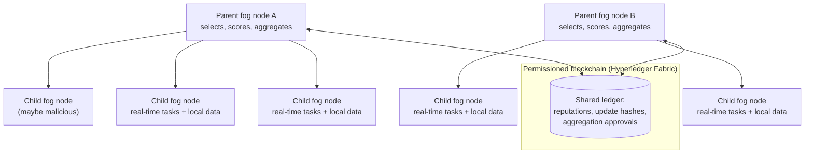
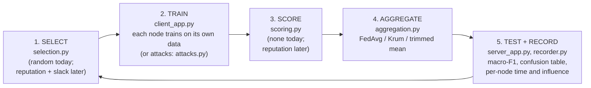

# rep-load-fl

Code for the master's dissertation **"Blockchain-Anchored Reputation for
Workload-Aware Scheduling and Aggregation of Federated Learning in
Hierarchical Fog Networks"** (BITS Pilani, Dubai Campus).

> **New to the ideas?** [`docs/CONCEPTS.md`](docs/CONCEPTS.md) explains every
> concept used here (fog networks, real-time tasks, federated learning, FedAvg,
> non-IID data, Flower, Edge-IIoTset, macro-F1, the four attacks, Krum, trimmed
> mean, reputation, Hyperledger Fabric) with small worked examples.

---

## What this project is about

### The problem

Factories, power plants and other industrial sites run **fog nodes**: small
servers next to the machines. These nodes have two jobs at once:

1. **Real-time work.** Control loops, alarms and monitoring tasks that **must
   finish before a deadline** (often a few milliseconds). Missing a deadline
   can mean a late alarm.
2. **Learning together.** Several sites want a shared **intrusion detector**,
   a model that recognises cyber-attacks in their network traffic, but none of
   them wants to hand over its raw traffic logs.

**Federated learning (FL)** solves the second job: the model travels to each
site, trains on local data, and only the trained weights come back. But it
creates three new problems:

- **Training competes with real-time work.** Training uses the same CPU. Pick
  a busy node, and its urgent tasks miss their deadlines.
- **Not every node is honest.** A compromised node can poison the model (wrong
  labels, reversed updates), free-ride (take part without training), or behave
  well for a while and then attack (on-off).
- **The coordinators don't trust each other either.** In a hierarchy, several
  parent fog nodes (from different plants or operators) each combine their
  children's updates. Any of them could cheat when aggregating, or inflate a
  favourite node's trust score.

### What we are trying to achieve

A federated learning system for hierarchical fog networks where:

- **Parent fog nodes choose which child nodes train each round using two
  signals together:** the node's **reputation** (how it behaved in past
  rounds) and its **live real-time load** (how much slack its deadline-bound
  tasks have right now).
- **Updates are aggregated weighted by reputation**, so distrusted nodes
  count for little.
- **Reputations and aggregation results are anchored on a permissioned
  blockchain** (Hyperledger Fabric), so parent nodes can check each other's
  work.
- The system **resists poisoning, free-riding and on-off attacks under
  non-IID data, while real-time tasks keep meeting their deadlines.**

### Why it's new

The literature splits into two families that never meet (details and
citations in [`docs/PROJECT_CONTEXT.md`](docs/PROJECT_CONTEXT.md)):

| Family | Example papers | What's missing |
|---|---|---|
| Load-aware selection | ELSA-FL, Lackinger et al. (LCN 2024) | assumes every client is honest; no attacks |
| Trust-aware selection | Rjoub 2024, Zhao 2024, BHFL 2025 | load means static or free capacity; no deadline-bound real-time tasks; weak attack tests (no on-off, no Krum or trimmed-mean baselines) |

**No published work selects FL trainers using reputation and deadline-bound
real-time load together.** That combination, tested against on-off attacks
and robust-aggregation baselines, is the contribution.

### Research questions

| | Question | Main measure |
|---|---|---|
| **RQ1** | Does selecting by reputation **plus** load keep deadlines better than reputation alone (and load alone)? | deadline-miss rate |
| **RQ2** | Does reputation-weighted aggregation resist poisoning and on-off attacks better than FedAvg, Krum and trimmed mean, under non-IID data? | macro-F1, attack success rate, recovery after on-off windows |
| **RQ3** | Can parent fog nodes detect a peer that aggregates incorrectly? | detection rate |
| **RQ4** | What latency and storage does the blockchain add, and what does it give that a central database doesn't? | latency, storage |

Out of scope: a new consensus protocol, encryption as the main contribution,
incentive mechanisms.

---

## How it works

### The system (target design)



### One training round (what the code does today)



**Design rule:** selection, scoring and aggregation are **separate, swappable
functions**, each registered in a dictionary and chosen by name in the YAML
config. Every experiment changes one of them and keeps the rest fixed, so
each comparison is fair.

| Module | Job | Available now |
|---|---|---|
| `src/bcfl/selection.py` | Choose which fog nodes train this round | `random`, `slack` (load-aware) |
| `src/bcfl/scoring.py` | Turn each node's behaviour into a trust score | `none` (everyone 1.0) |
| `src/bcfl/aggregation.py` | Combine the updates; report each node's influence | `fedavg`, `krum`, `trimmed_mean` |

### Under the hood

- **[Flower](https://flower.ai)** 1.42 runs the federated rounds and simulates
  every fog node as its own process (via Ray) on one machine.
  `strategy.py` (`RepLoadStrategy`) extends Flower's FedAvg strategy, replacing
  only the select and aggregate steps with our modules.
- **PyTorch** trains the model: a small MLP (90 features → 128 → 64 → 15
  classes, 20,879 weights) for Edge-IIoTset, or a CNN for CIFAR-10.
- **Krum and trimmed mean** use Flower's own implementations
  (`select_multikrum`, `trim_mean`), wrapped so they fit our pipeline and log
  influence.
- **Attacks** run inside the fog node (`client_app.py` + `attacks.py`). Each
  node also reports ground truth (`is_malicious`, `attacking`), which is
  logged for evaluation only and never used by the methods.

---

## Status and roadmap

- [x] **Step 1: baseline.** Flower + PyTorch, 20 fog nodes, CIFAR-10 with a
  Dirichlet non-IID split, FedAvg, accuracy curves (PRs #1, #2).
- [x] **Attack and defence definitions** agreed in
  [`docs/step2_attack_spec.md`](docs/step2_attack_spec.md) (PR #3).
- [x] **Week 1, dataset:** switch to Edge-IIoTset (intrusion detection), MLP,
  macro-F1 and confusion tables (PR #4).
- [x] **Week 1, attacks and defences:** label flip, scaling, free-riding,
  on-off; Krum and trimmed mean; per-node influence logging (PR #5).
- [x] **Week 1, experiments:** the 45-run attack × defence grid
  (`scripts/run_week1_attacks.sh`) and the results tables (`scripts/summarise_week1.py`, PR #7).
- [x] **Week 2, workload model:** real-time jobs with deadlines (RTH²S
  parameters), training competing for CPU (fair share or EDF), deadline-miss rate,
  late updates dropped, slack-aware selection.
- [ ] **Week 2, reputation:** reputation scoring, reputation + slack
  selection, reputation-weighted aggregation (RQ1, RQ2).
- [ ] **Blockchain:** Fabric anchoring of reputations and peer verification
  of aggregation (RQ3, RQ4).
- [ ] Thesis and journal paper.

**Final Week 1 settings** (these replace the CIFAR-based draft values in the
attack spec): Edge-IIoTset, α = 0.5, 20 nodes with 10 per round, 100 rounds,
3 seeds; 20% malicious nodes chosen at random; label flip Backdoor → Normal;
scaling with s = −1; plain free-riding; on-off with 10 honest / 5 attacking
rounds; Krum f = 2 and trimmed mean k = 2.

---

## Setup

```bash
conda create -n replfl -c conda-forge --override-channels python=3.13 -y   # 3.11-3.13 work; tested on 3.13
conda activate replfl
pip install -r requirements.txt
pip install -e .          # makes `bcfl` importable from scripts and tests
pytest                    # unit tests (30 tests)
```

`--override-channels` with conda-forge avoids Anaconda's default channels,
which require accepting their terms of service.

## Data: Edge-IIoTset

The main dataset is **Edge-IIoTset** (Ferrag et al., IEEE Access 2022):
network traffic from an IoT/IIoT testbed with edge and fog layers, labelled as
Normal or one of 14 attacks.

1. Download it from Kaggle ("Edge-IIoTset Cyber Security Dataset of IoT &
   IIoT") and copy
   `Edge-IIoTset dataset/Selected dataset for ML and DL/DNN-EdgeIIoT-dataset.csv`
   into `data/`.
2. Prepare it **once**:
   ```bash
   python scripts/prepare_edgeiiot.py --csv data/DNN-EdgeIIoT-dataset.csv --out data/edgeiiot
   ```
   This drops leaky columns (timestamps, IPs, ports, raw payloads,
   `udp.stream`), removes duplicates, one-hot encodes text columns, makes a
   stratified 80/20 split, scales using the training data only, and saves
   `float32` `.npy` files that every simulated node memory-maps. Result:
   **1,799,638 rows, 90 features, 15 classes, about 76% Normal.**
3. **For quick smoke tests**, also prepare a 5% sample into
   `data/edgeiiot_sample` (the folder `configs/edgeiiot_smoke.yaml` reads):
   ```bash
   python -c "
   import pandas as pd
   df = pd.read_csv('data/DNN-EdgeIIoT-dataset.csv', low_memory=False)
   df.sample(frac=0.05, random_state=0).to_csv('data/edge_sample_5pct.csv', index=False)
   "
   python scripts/prepare_edgeiiot.py --csv data/edge_sample_5pct.csv --out data/edgeiiot_sample
   ```

Because the data is about 76% Normal, **always report macro-F1 alongside
accuracy**: a model that always answers "Normal" gets about 76% accuracy but a
macro-F1 of about 0.06.

The older CIFAR-10 baseline (`configs/baseline.yaml`) still works and
downloads CIFAR-10 by itself.

## Running experiments

```bash
# Quick checks
python scripts/run.py --config configs/smoke.yaml               # fake data, about a minute
python scripts/run.py --config configs/edgeiiot_smoke.yaml      # 5% sample, 5 nodes, 3 rounds

# One full run: Edge-IIoTset, 20 nodes, 10 per round, 100 rounds, FedAvg, no attack
python scripts/run.py --config configs/edgeiiot_baseline.yaml

# Change any setting without editing the file
python scripts/run.py --config configs/edgeiiot_baseline.yaml \
  --set methods.aggregation=krum --set attack.type=scaling --set seed=1

# Clean baseline: alpha 0.1 / 0.5 / 100 x 3 seeds, then plots
bash scripts/run_edgeiiot_baseline.sh

# Week 1 attack grid: 5 attack settings x 3 aggregators x 3 seeds = 45 runs
# (long: run it overnight; finished runs are skipped if restarted)
nohup bash scripts/run_week1_attacks.sh > week1_attacks.log 2>&1 &

# Turn the 45 runs into tables (summary.md, runs.csv) and charts in results/week1_summary/
python scripts/summarise_week1.py

# Plot any set of runs (seeds averaged; shaded band = min to max)
python scripts/plot.py results/edgeiiot_baseline_alpha0.5_seed* --metric test_macro_f1 \
  --output results/alpha05_macro_f1.png
```

### Main config settings

| Setting | Values | Meaning |
|---|---|---|
| `data.alpha` | 0.1, 0.5, 100 | non-IID strength: smaller = more uneven |
| `federation.num_nodes` / `nodes_per_round` / `num_rounds` | 20 / 10 / 100 | size of the federation and length of the run |
| `methods.selection` | `random`, `slack` | who trains: at random, or only nodes whose training fits their spare CPU |
| `methods.aggregation` | `fedavg`, `krum`, `trimmed_mean` | how updates are combined |
| `workload.enabled` | `false` / `true` | simulate each fog node's real-time jobs (RTH²S parameters) and count deadline misses |
| `workload.training_policy` | `fair_share`, `edf` | training shares the CPU like an ordinary process, or runs as an EDF job due at the round's end |
| `methods.assumed_malicious_fraction` | 0.2 | attackers Krum and trimmed mean are told to expect (→ f = k = 2) |
| `attack.type` | `none`, `label_flip`, `scaling`, `free_rider`, `on_off` | what the malicious nodes do |
| `attack.fraction` | 0.2 | share of nodes that are malicious (4 of 20) |
| `attack.scale` | −1.0 | scaling / on-off: sent = global + s × (local − global) |
| `attack.honest_rounds` / `attack_rounds` | 10 / 5 | the on-off cycle |
| `seed` | 0, 1, 2 | controls the split, selection, model start and attacker choice |

### What each run saves

Each run writes to `results/<run_name>_alpha<α>_seed<s>/` (git-ignored):

| File | Contents |
|---|---|
| `config.yaml` | The exact settings used |
| `split.json` | How many rows of each class every node holds |
| `rounds.csv` | Per round: test accuracy, loss and macro-F1, average training loss, selected nodes, slowest node's training time, round time |
| `node_rounds.csv` | Per node per round: rows used, training loss, wall-clock and CPU training time, `is_malicious`, `attacking`, `influence`, `on_time`, `slack_s` |
| `workload.csv` | With the workload on: per node (selected or not) per round: busy or normal, load, speed, slack, simulated training time, real-time jobs and misses with and without training. `rounds.csv` then also has `deadline_miss_rate`, `deadline_miss_rate_without_fl` and `late_updates` |
| `confusion.jsonl` | The test confusion table per round, used for attack success rates (e.g. Backdoor rows predicted as Normal) |

On an Apple Silicon Mac you can try `--set training.device=mps`. If it is
slower, or errors with many parallel nodes, stay on `cpu`.

---

## Repository layout

```
src/bcfl/
  data.py          load datasets, Dirichlet split, per-node data loaders
  model.py         MLP / CNN, training loop, test with macro-F1 and confusion table
  selection.py     SELECT step (registry: random)
  scoring.py       SCORE step (registry: none)
  aggregation.py   AGGREGATE step (registry: fedavg, krum, trimmed_mean) + influence
  attacks.py       malicious nodes: who, when, and the four attacks
  workload.py      real-time jobs per fog node, EDF / fair-share CPU simulation, slack
  strategy.py      RepLoadStrategy: our Flower strategy calling the three steps
  client_app.py    the fog-node program (trains, or attacks)
  server_app.py    the coordinator program (runs rounds, tests the global model)
  recorder.py      writes rounds.csv, node_rounds.csv, confusion.jsonl
  config.py        loads YAML configs and --set overrides
configs/           experiment configs (YAML)
scripts/           run.py, prepare_edgeiiot.py, plot.py, experiment shell scripts
tests/             unit tests (pytest)
docs/              concepts, research context, attack spec
results/           run outputs (git-ignored)
data/              datasets (git-ignored)
```

## Documentation

| Document | What's in it |
|---|---|
| [`docs/CONCEPTS.md`](docs/CONCEPTS.md) | Every concept used in the project, explained with worked examples, plus a glossary |
| [`docs/PROJECT_CONTEXT.md`](docs/PROJECT_CONTEXT.md) | The mentor's direction, research questions, novelty analysis and related papers |
| [`docs/step2_attack_spec.md`](docs/step2_attack_spec.md) | How each attack and defence is defined and measured (draft written for CIFAR-10; see the final Week 1 settings above) |
| [`CLAUDE.md`](CLAUDE.md) | Working rules for the repo (branches and PRs, code style, tests before PRs) |

## Contributing workflow

- Never commit to `main`: work on a feature branch and open a pull request.
- Keep code simple and readable: small functions, plain loops, comments that
  explain *why*.
- Before opening a PR, run `pytest` and a smoke config.
