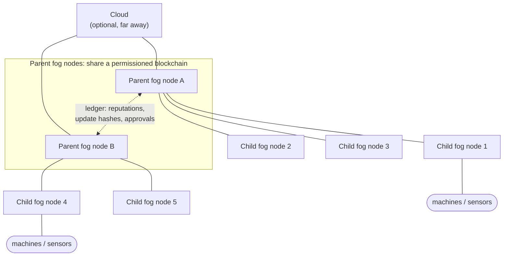
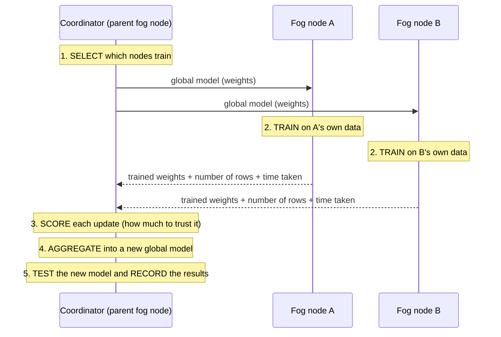
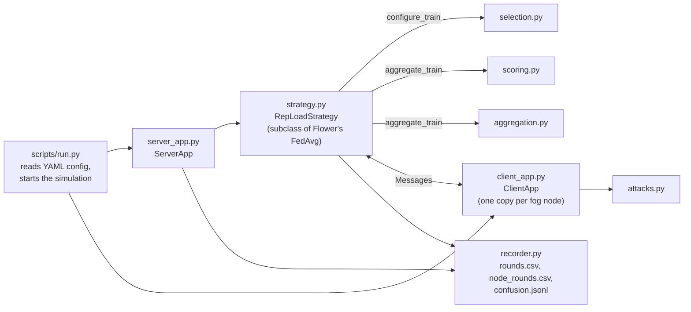

# Concepts: everything this project is built on

This page explains every idea the project uses, from "what is a fog node?" to
Krum, trimmed mean and Hyperledger Fabric. Each concept comes with a small
worked example you can check by hand. Read it top to bottom the first time;
afterwards, use the [glossary](#glossary) at the end to look things up.

Sections marked **(planned)** describe parts of the thesis that are not
implemented yet. Their design may still change.

## Contents

1. [The setting: fog networks and real-time tasks](#1-the-setting-fog-networks-and-real-time-tasks)
2. [Machine learning in one page](#2-machine-learning-in-one-page)
3. [Federated learning](#3-federated-learning)
4. [FedAvg](#4-fedavg)
5. [Non-IID data and the Dirichlet split](#5-non-iid-data-and-the-dirichlet-split)
6. [Flower, the FL framework we use](#6-flower-the-fl-framework-we-use)
7. [The dataset: Edge-IIoTset](#7-the-dataset-edge-iiotset)
8. [Preparing the data](#8-preparing-the-data)
9. [The model: an MLP](#9-the-model-an-mlp)
10. [Measuring results](#10-measuring-results)
11. [Attacks](#11-attacks)
12. [Defences: Krum and trimmed mean](#12-defences-krum-and-trimmed-mean)
13. [Reputation (planned)](#13-reputation-planned)
14. [Reputation + load selection (planned): the novelty](#14-reputation--load-selection-planned-the-novelty)
15. [Blockchain and Hyperledger Fabric (planned)](#15-blockchain-and-hyperledger-fabric-planned)
16. [Reproducibility](#16-reproducibility)
17. [Glossary](#glossary)
18. [References](#references)

---

## 1. The setting: fog networks and real-time tasks

### Cloud, fog and edge

- **Edge devices** are the sensors, machines and cameras that produce data.
- **The cloud** is a big, far-away data centre. It is powerful, but sending
  everything there is slow and exposes the data.
- **Fog nodes** sit in between: small servers or gateways *close to* the edge,
  for example a gateway on a factory floor. They are much weaker than the
  cloud but answer in milliseconds.

A **hierarchical fog network** has several layers of fog nodes. In this
project:

- **Child fog nodes** sit next to the machines. They hold local data and run
  local real-time work.
- **Parent fog nodes** each look after a group of children. They coordinate
  training and combine (aggregate) the children's results.
- **Parents don't fully trust each other.** They may belong to different
  plants or operators. That is why they share a blockchain (section 15).



**Example (our chosen domain, Industrial IoT).** A factory gateway (a child
fog node) reads sensor values and must raise an alarm within 20 ms if a
pressure valve misbehaves. The same gateway also helps train an **intrusion
detector**: a model that recognises cyber-attacks in the plant's network
traffic. Training is useful, but the alarm must never be late.

### Real-time tasks and deadlines

A **real-time task** is a job that must finish before a **deadline**.
Finishing late counts as a failure, even if the answer is correct.

- **Execution time (C):** how much CPU time the task needs.
- **Deadline (D):** the time by which it must be done.
- **Deadline miss:** the task finished after its deadline.
- **Deadline-miss rate:** missed tasks ÷ all tasks. This is the main measure
  for RQ1.

### Slack (laxity)

**Slack** is how much spare time a task has before it *must* start running
to still meet its deadline:

```
slack = deadline − current time − remaining execution time
```

**Example.** At time 10 ms, a task has a deadline at 50 ms and still needs
20 ms of CPU:

```
slack = 50 − 10 − 20 = 20 ms
```

The node can spend up to 20 ms on something else (like training) and the task
still finishes on time. If training takes 30 ms of CPU in that window, the
task misses its deadline by 10 ms.

Slack is also called **laxity**. RTH²S (Kaur et al.), the base paper on
real-time scheduling across fog tiers, uses laxity to decide which tasks run
where.

### Why this matters for FL

Training a model uses the **same CPU** that the real-time tasks need. If the
coordinator picks a busy node for training, that node's urgent tasks may miss
deadlines. So the question "who should train this round?" has two sides:

1. **Is the node trustworthy?** (reputation, section 13)
2. **Can the node afford the CPU time right now?** (load and slack)

Combining both is this project's novelty (section 14).

---

## 2. Machine learning in one page

### Model, weights, prediction

A **model** is a function with adjustable numbers inside it, called
**weights** (or **parameters**). Given an input (one row of network traffic),
it outputs a guess (which of the 15 classes the row belongs to).

**Training** means nudging the weights until the guesses get better.

### Loss

The **loss** is one number that says how wrong the model is: 0 means perfect,
bigger means worse. We use **cross-entropy loss**. It looks at the
probability the model gave to the *correct* class:

| Probability given to the correct class | Loss = −ln(probability) |
|---|---|
| 0.9 (confident and right) | 0.11 |
| 0.5 (unsure) | 0.69 |
| 0.1 (confident and wrong) | 2.30 |

With 15 classes, a model that guesses uniformly gives each class 1/15, so its
loss is −ln(1/15) ≈ **2.71**. Training should push the loss well below that.

### Gradient descent and the learning rate

For every weight, training works out which direction would lower the loss
(the **gradient**), then moves the weight a small step that way:

```
new weight = old weight − learning_rate × gradient
```

**Example.** A weight is 0.40, its gradient is −2.0 and the learning rate is
0.01: the new weight is 0.40 − 0.01 × (−2.0) = **0.42**. A bigger learning rate
takes bigger steps: faster, but it can overshoot. We use 0.01.

### Batch, epoch, round: the three loops

| Term | Meaning | Example (a node with 14,000 rows, batch size 256) |
|---|---|---|
| **Batch** | A small group of rows; one weight update per batch | 256 rows |
| **Epoch** | One full pass over the node's own data | 14,000 / 256 ≈ 55 batches = 55 updates |
| **Round** | One federated cycle: select → train → aggregate → test | each selected node does 1 epoch (`local_epochs: 1`) |

So 100 rounds means each node trains for one epoch **whenever it is
selected**. With 10 of 20 nodes picked at random, that's about 50 epochs per
node over the whole run.

### Train set and test set

- **Training set:** the data the model learns from.
- **Test set:** data the model never trains on. It is used only to measure
  how well the model works on *new* data.

If you test on training data, you measure memory, not understanding.

---

## 3. Federated learning

### The idea

In normal machine learning, all data is copied to one place and the model is
trained there. **Federated learning (FL)** turns this around: **the model
travels to the data, and the data never leaves the nodes.**

Why:
- **Privacy and confidentiality:** a plant's traffic logs stay in the plant.
- **Bandwidth:** sending a 20,879-number model is cheaper than sending
  millions of rows.
- **Regulation:** some data may legally not leave a site.

### One round



Then the next round starts from the new global model. In this project the five
steps map onto separate files:

| Step | File | Current default |
|---|---|---|
| 1. Select | `src/bcfl/selection.py` | random |
| 2. Train | `src/bcfl/client_app.py` | 1 local epoch (or an attack) |
| 3. Score | `src/bcfl/scoring.py` | none (everyone scores 1.0) |
| 4. Aggregate | `src/bcfl/aggregation.py` | FedAvg, Krum or trimmed mean |
| 5. Test and record | `src/bcfl/server_app.py`, `recorder.py` | central test set |

### What FL does *not* protect against

The coordinator can't see the nodes' data, so it can't check whether a node
trained honestly. A node can lie about its data, its labels, or its update.
That is what sections 11–13 are about.

---

## 4. FedAvg

**FedAvg** (McMahan et al., 2017) is the standard way to combine updates: a
**weighted average** of the nodes' models, where each node's weight is its
share of the data.

```
node's share = node's rows / total rows of all selected nodes
new model    = Σ (share × node's model)
```

**Worked example.** Three nodes; to keep it simple, each model is a single
number:

| Node | Its model | Rows | Share |
|---|---|---|---|
| 1 | 0.0 | 100 | 100 / 1000 = **0.1** |
| 2 | 10.0 | 300 | 300 / 1000 = **0.3** |
| 3 | 5.0 | 600 | 600 / 1000 = **0.6** |

```
new model = 0.1 × 0.0 + 0.3 × 10.0 + 0.6 × 5.0 = 0 + 3 + 3 = 6.0
```

Node 3 has the most say because it has the most data, even though node 2
moved furthest.

In a real model, the same average is done **separately for every one of the
20,879 weights**.

**Weakness:** FedAvg trusts everyone. It believes every node's row count and
every node's update. One attacker sending extreme values can drag the average
anywhere (section 12).

---

## 5. Non-IID data and the Dirichlet split

### IID vs non-IID

- **IID** (independent and identically distributed): every node's data looks
  like a small copy of the whole dataset, with the same mix of classes.
- **Non-IID:** nodes have *different* mixes. In reality this is normal: one
  plant sees mostly DDoS attacks, another mostly scanning, a third almost only
  normal traffic.

Non-IID data makes FL harder. Honest nodes' updates point in different
directions, so they disagree with each other even with no attacker present.
It also makes attacks harder to spot, because an *honest* node with unusual
data can look like an outlier.

### The Dirichlet split

To *simulate* non-IID data, we split each class across the nodes using random
proportions drawn from a **Dirichlet distribution** with parameter **α
(alpha)**:

- **Small α** (e.g. 0.1): very uneven. Each class lands mostly on one or two
  nodes.
- **Large α** (e.g. 100): almost even. Close to IID.

**Real example** (4 nodes, seed 0, percentages of each class given to each
node, rounded):

| Class | α = 0.1 (very non-IID) | α = 100 (almost IID) |
|---|---|---|
| Normal | 8, 0, **88**, 5 | 24, 26, 23, 27 |
| DDoS_UDP | 1, 16, **84**, 0 | 26, 27, 22, 25 |
| Backdoor | 0, 37, 16, 47 | 24, 27, 25, 24 |

At α = 0.1, node 3 gets 88% of all Normal traffic and node 1 gets no Backdoor
at all. At α = 100, every node gets about a quarter of everything.

We run **α = 0.1, 0.5 and 100**. α = 0.5 is the main setting: clearly
non-IID, but not extreme. `min_samples_per_node` (100 by default) redraws the
split if any node ends up with almost no data.

The split is saved in each run's `split.json`, so you can see exactly which
node holds what.

---

## 6. Flower, the FL framework we use

**Flower** (`flwr`, version 1.42 pinned in `requirements.txt`) is an
open-source Python framework for federated learning. It handles the plumbing:
sending models to nodes, collecting replies, running rounds, and simulating
many nodes on one laptop. We write only the research parts.

### The pieces

| Flower piece | What it is | In this repo |
|---|---|---|
| `ServerApp` | The program on the coordinator | `server_app.py` |
| `ClientApp` | The program on every fog node | `client_app.py` |
| `Strategy` | The coordinator's rules: who trains, how to combine | `strategy.py` (`RepLoadStrategy`) |
| `Message` | What travels between coordinator and node | built in `client_app.py`, `strategy.py` |
| `ArrayRecord` | Model weights inside a message | the global or trained model |
| `MetricRecord` | Numbers inside a message | rows, loss, training time, ground truth |
| `ConfigRecord` | Settings inside a message | e.g. `server-round` |
| `Grid` | The coordinator's handle for sending messages | used by the strategy |
| Simulation (Ray) | Runs every fog node as its own process on one machine | `scripts/run.py` |

### How our code uses Flower



### Why a custom strategy?

Flower ships ready-made strategies (`FedAvg`, `Krum`, `FedTrimmedAvg`, …).
Each is a whole package: it picks nodes *and* combines updates in its own way.
We need to swap **selection**, **scoring** and **aggregation** independently,
and to log extra information. So `RepLoadStrategy` inherits from Flower's
`FedAvg` (keeping all the message handling and the round loop, `start()`) and
overrides only two methods:

- `configure_train()`: **select** the nodes, using our `selection.py`.
- `aggregate_train()`: **score** and **aggregate**, using our `scoring.py`
  and `aggregation.py`.

For Krum and trimmed mean we still use **Flower's own maths**: our
`aggregation.py` calls the functions inside Flower's `Krum` and
`FedTrimmedAvg` (section 12).

### Registries: swapping methods from the config

Each of the three files has a dictionary of available methods:

```python
AGGREGATORS = {"fedavg": fedavg, "krum": krum, "trimmed_mean": trimmed_mean}
```

The YAML config picks one by name (`methods.aggregation: krum`). Adding a new
method means writing one function with the same shape and adding one line to
the dictionary. No other file changes.

### Simulation

`run_simulation` starts one process per fog node (using **Ray**). Each process
loads only its own slice of the data. Processes don't share memory, which is
why things like "which nodes are malicious" are computed from the **seed** in
every process instead of being passed around (section 16).

---

## 7. The dataset: Edge-IIoTset

**Edge-IIoTset** (Ferrag et al., *IEEE Access*, 2022) is network traffic
recorded on a realistic IoT / Industrial IoT testbed with edge and fog layers.
Each row describes network packets with features such as protocol flags,
lengths and MQTT/HTTP/DNS fields. Each row is labelled as **Normal** or one
of **14 attacks**.

We use the "Selected dataset for ML and DL" file (`DNN-EdgeIIoT-dataset.csv`,
about 2.2 million rows before cleaning).

| # | Class | What it is |
|---|---|---|
| 0 | Backdoor | hidden remote access left on a device |
| 1 | DDoS_HTTP | flooding a web server with HTTP requests |
| 2 | DDoS_ICMP | flooding with ping (ICMP) packets |
| 3 | DDoS_TCP | flooding with TCP connection attempts |
| 4 | DDoS_UDP | flooding with UDP packets |
| 5 | Fingerprinting | probing devices to identify their OS and software |
| 6 | MITM | man-in-the-middle: intercepting traffic (ARP/DNS spoofing) |
| 7 | **Normal** | ordinary traffic, about **76%** of rows after cleaning |
| 8 | Password | password-guessing attacks |
| 9 | Port_Scanning | scanning which ports are open |
| 10 | Ransomware | malware that encrypts data for ransom |
| 11 | SQL_injection | malicious database queries via a web form |
| 12 | Uploading | uploading malicious files |
| 13 | Vulnerability_scanner | automated scanning for known weaknesses |
| 14 | XSS | cross-site scripting: injecting scripts into web pages |

The numbers are the class ids used in the code (alphabetical order). For
example, the label-flip attack turns class **0** (Backdoor) into class **7**
(Normal).

**Why this dataset:** it comes from an IoT/edge/fog setting, it is widely
cited, and intrusion detection is a natural shared task for plants that don't
want to share raw traffic.

**Imbalance:** some classes are tiny. Fingerprinting and MITM are each well
under 1% of rows. Combined with a non-IID split, some nodes hold none of them.

---

## 8. Preparing the data

`scripts/prepare_edgeiiot.py` runs **once** and turns the raw CSV into clean
number arrays. Every step has a reason.

### Leakage and shortcut learning: dropping identifier columns

**Leakage** is when a feature gives the answer away for reasons that won't
hold in real life. The model then learns a **shortcut** instead of the real
pattern.

| Dropped columns | Why they leak |
|---|---|
| `frame.time`, `icmp.transmit_timestamp` | Attacks were recorded at specific times in the testbed. The model would learn "traffic at 14:03 is DDoS", which is useless in a real plant |
| `ip.src_host`, `ip.dst_host`, ARP IPs | In the testbed, the attacker machine had fixed IPs. The model would learn "this IP is the attacker" |
| `tcp.srcport`, `tcp.dstport`, `udp.port` | Port numbers mostly identify the connection, not the behaviour |
| `http.file_data`, `http.request.full_uri`, `tcp.payload`, `mqtt.msg`, … | Raw payload text: unique per row, and hard to turn into numbers |
| `udp.stream` | A stream counter: rows from one attack session share nearby values |
| `Attack_label` | 0/1 "is it an attack". It *is* the answer |

**Example:** without dropping IPs, a model might reach 99% accuracy just by
learning "source 192.168.0.170 = attack". Move the attacker to another
machine and it detects nothing.

### Removing duplicates

Many rows are exact copies (floods send the same packet over and over). If a
copy ends up in both the training and test set, the test measures memory, not
understanding. After removing duplicates: **1,799,638 rows**. Some classes
shrink a lot: DDoS_UDP lost about 90% of its rows, MITM about 70%.

### One-hot encoding

A model needs numbers, but some columns contain text. **One-hot encoding**
turns one text column into several 0/1 columns, one per possible value.

**Example:** `http.request.method` with values `GET`, `POST`, `0`:

| method | → | method_GET | method_POST | method_0 |
|---|---|---|---|---|
| GET | | 1 | 0 | 0 |
| POST | | 0 | 1 | 0 |
| 0 | | 0 | 0 | 1 |

Why not just GET = 1, POST = 2? That would tell the model POST is "twice" GET,
which means nothing.

Columns where every row has the same value are dropped too: they carry no
information. The result is **90 features** (the 5% sample gives 70, because
some text values never appear in it).

### Stratified train/test split

The data is split **80% train, 20% test**, **stratified** by class: each class
keeps the same proportion in both parts.

**Example:** with a class of only 50 rows, a purely random split could, by bad
luck, put all 50 in training, so the test set wouldn't contain that class at
all. Stratified, it puts 40 in train and 10 in test.

### Scaling (standardisation)

Features have very different ranges (a packet length of 1,500 vs a flag of
0/1). Big numbers would dominate training. **StandardScaler** rescales each
feature to mean 0 and standard deviation 1:

```
scaled = (value − mean) / standard deviation
```

**Example:** a feature with mean 500 and standard deviation 200. A value of
900 becomes (900 − 500) / 200 = **2.0**: "two standard deviations above
average".

The mean and standard deviation come **from the training set only**, then
are applied to both sets. Computing them on the test set too would leak
information about the test data into training.

### float32 and memory mapping

The arrays are saved as **float32** (4 bytes per number, half of float64):
1.4 million rows × 90 features ≈ 518 MB for training. Each simulated node
opens the file with **memory mapping** (`mmap_mode="r"`): the operating system
loads only the rows that node actually reads, instead of 20 processes each
loading the whole file into RAM.

---

## 9. The model: an MLP

For Edge-IIoTset we use a small **multi-layer perceptron (MLP)**: a stack of
fully connected layers.

```
90 features → [128 neurons] → ReLU → [64 neurons] → ReLU → [15 outputs]
```

- **Linear layer:** every output is a weighted sum of all inputs, plus a bias.
- **ReLU:** keeps positive numbers, turns negatives into 0. Without it, the
  stacked layers would collapse into one big linear sum and couldn't learn
  complex patterns.
- **15 outputs:** one score per class. The highest score is the prediction.

**Counting the weights:**

| Layer | Weights | Biases | Total |
|---|---|---|---|
| 90 → 128 | 90 × 128 = 11,520 | 128 | 11,648 |
| 128 → 64 | 128 × 64 = 8,192 | 64 | 8,256 |
| 64 → 15 | 64 × 15 = 960 | 15 | 975 |
| **All** | | | **20,879** |

So every fog node sends **20,879 numbers** per round. The CIFAR-10 CNN from
Step 1 had 545,098: the MLP is about 26 times smaller, which makes the
45-run experiment grid feasible on a laptop.

Model code: `src/bcfl/model.py` (`MLP`, `build_model`, `train`, `test`).

---

## 10. Measuring results

### Accuracy

```
accuracy = correct predictions / all predictions
```

Simple, but **misleading on imbalanced data**.

### Confusion matrix

A table where **rows are the true class** and **columns are the predicted
class**. The diagonal holds the correct predictions.

**Example** (3 classes, 100 test rows):

| true ↓ / predicted → | Normal | DDoS | Backdoor |
|---|---|---|---|
| **Normal** | **70** | 2 | 0 |
| **DDoS** | 3 | **15** | 2 |
| **Backdoor** | 5 | 0 | **3** |

Accuracy = (70 + 15 + 3) / 100 = 88%. But look at the Backdoor row: only 3
of 8 backdoor rows were caught. Five were called Normal.

Every Edge-IIoTset run saves the confusion matrix of every round in
`confusion.jsonl`, so anything below can be recomputed later without
rerunning.

### Precision, recall, F1 (per class)

For one class, say Backdoor:

- **Precision:** of everything the model *called* Backdoor, how much really
  was? = 3 / (3 + 0 + 2) = 3 / 5 = **0.60** (column total).
- **Recall:** of all *real* Backdoor rows, how many did it catch?
  = 3 / 8 = **0.375** (row total).
- **F1:** a single number balancing the two (their harmonic mean):
  `F1 = 2 × P × R / (P + R)` = 2 × 0.60 × 0.375 / 0.975 ≈ **0.46**.

For an intrusion detector, **recall on attack classes** matters a lot: a
missed attack is worse than a false alarm.

### Macro-F1, and the "lazy model"

**Macro-F1** = the plain average of the F1 scores of all classes. Every class
counts equally, however small.

**The lazy model** always answers "Normal". On Edge-IIoTset (about 76%
Normal):

- Accuracy = **76%**. That looks decent!
- Normal: precision 0.76, recall 1.0, so F1 = 2 × 0.76 × 1 / 1.76 ≈ 0.86.
- The 14 attack classes: never predicted, so F1 = 0.
- Macro-F1 = (0.86 + 14 × 0) / 15 ≈ **0.058**.

A useless detector gets 76% accuracy but a macro-F1 of about 0.06. That's why
we **always report macro-F1 next to accuracy**. Early FL rounds often show
exactly this pattern (accuracy ≈ 0.77, macro-F1 ≈ 0.06) before the model
learns to tell attacks apart.

### Attack success rate (ASR)

For the targeted label-flip attack (Backdoor → Normal):

```
ASR = Backdoor test rows predicted as Normal / all Backdoor test rows
    = confusion[0][7] / sum(confusion[0])
```

**Example:** 2,000 Backdoor rows in the test set, 1,400 predicted Normal →
ASR = **70%**: 70% of backdoor traffic would slip through undetected.

Overall accuracy barely moves under this attack (Backdoor is about 1% of
rows), so ASR is the number that shows it. Compare it with the ASR of the
same aggregator's no-attack run: some Backdoor rows are misclassified as
Normal even without an attack.

### Influence (our logging)

**Influence** = how much of the new global model came from each node. Shares
are between 0 and 1 and add up to 1. Every aggregator returns it, and it is
logged per node per round in `node_rounds.csv`.

| Aggregator | Influence | Example (10 nodes, equal data) |
|---|---|---|
| FedAvg | the node's data share | everyone 0.10, attackers included |
| Krum | 1.0 for the one chosen update, 0 for the rest | 1.0 for the winner |
| Trimmed mean | share of the node's values that survived trimming | attackers usually ≈ 0 |

This answers one question the same way for every defence: **"how much of the
model did the attackers get?"** For example, under FedAvg, 2 free-riders out
of 10 capture about **20%** of the model while doing no work.

### Wall-clock time vs CPU time

Each node logs two training times:

- `train_seconds`: **wall-clock** time, as a stopwatch would measure. Inflated
  when many simulated nodes share the laptop's CPU at once.
- `train_cpu_seconds`: **CPU time** used by the node's own process. Closer to
  "how much computing training needs", so it is the input for the workload
  model (section 14).

Round 1 is slower for everyone: each worker process warms up first.

---

## 11. Attacks

All attack code is in `src/bcfl/attacks.py`, and the settings are in the
`attack:` section of the config.

### Threat model

- **20%** of fog nodes are malicious (4 of 20), fixed for the whole run.
- Which nodes are malicious is drawn from the run's seed (`seed + 1000`), so
  every process agrees without talking to each other. Seed 0 gives nodes
  `[3, 9, 12, 16]`, seed 1 gives `[0, 11, 15, 18]`.
- Attackers know the global model, their own data and the training procedure.
  They don't see other nodes' updates and don't know which defence is used.
- All malicious nodes run the same attack in a run.
- They report their **true** row count.

Since 10 of 20 nodes are picked at random each round, a round contains on
average 2 attackers, sometimes 0, sometimes 4 or more.

**Ground truth.** Every node reports `is-malicious` (one of the bad nodes?) and
`attacking` (did it attack *this* round?). These are logged in
`node_rounds.csv` **for evaluation only**. The selection, scoring and
aggregation code never reads them. A real attacker would never admit it!

### Label flipping (data poisoning)

The attacker trains normally, but on **poisoned labels**: every row of one
class is relabelled as another class before training.

Our setting: **Backdoor (0) → Normal (7)**. The attacker wants its own kind of
attack traffic to be classified as harmless.

**Example:** the labels `[0, 7, 0, 3, 7]` become `[7, 7, 7, 3, 7]`. Only the two
Backdoor rows change.

- **When:** before training.
- **Measured by:** ASR (section 10).
- **Note:** under non-IID data, a randomly chosen attacker may hold very few
  Backdoor rows, so its attack is weak by accident. The run's `split.json`
  shows how many it actually held.

### Scaling (model poisoning)

The attacker trains honestly, then **reverses and/or amplifies** what it
learned before sending:

```
sent = global + s × (local − global)
```

`local − global` is what the node learned this round. The factor *s* decides
what it sends instead:

| s | Meaning | Example: global 0.40, local 0.42 (learned +0.02) |
|---|---|---|
| +1 | honest | 0.40 + 0.02 = **0.42** |
| **−1** (our default) | reversed: pushes the model the wrong way | 0.40 − 0.02 = **0.38** |
| −5 | reversed and 5× stronger | 0.40 − 0.10 = **0.30** |

- **When:** after training.
- **Measured by:** the macro-F1 / accuracy drop compared with the same
  aggregator's no-attack run.

### Free-riding

The free-rider **doesn't train at all**. It sends back the global model it
received, but still reports its real row count, so FedAvg gives it a full
share of the average.

- It gets the improved model every round **for free**: no CPU spent
  (`train_cpu_seconds ≈ 0`).
- It doesn't wreck the model, but it **slows learning**. A zero change with 20%
  of the weight means each round moves only about 80% as far.
- It **wastes a training slot** a useful node could have had.

`noise_std` can add tiny random noise (e.g. 0.001) so the update isn't
*exactly* the global model, which makes it harder to catch. Default: 0 (plain
free-riding).

**Measured by:** the influence captured by free-riders, and the slowdown in
learning.

### On-off attack

The attacker **alternates**: honest for a while (to build trust), then
attacking, then honest again (to rebuild trust). This is designed to beat
reputation systems.

Our setting: **10 rounds honest, then 5 rounds attacking (scaling, s = −1)**,
repeated.

The code works out the position in the 15-round cycle with the remainder
(modulo) operator:

```python
position_in_cycle = (server_round - 1) % 15     # 0 ... 14
attacking = position_in_cycle >= 10              # positions 10-14 attack
```

| Round | 1 | … | 10 | **11** | … | **15** | 16 | … | **26** | … | **90** | 91 … 100 |
|---|---|---|---|---|---|---|---|---|---|---|---|---|
| Position | 0 | | 9 | **10** | | **14** | 0 | | **10** | | **14** | 0 … 9 |
| Attacking? | no | | no | **yes** | | **yes** | no | | **yes** | | **yes** | no |

In 100 rounds that makes 6 full cycles (rounds 1–90), so **30 attack rounds**.
An attacker that isn't selected during its window simply misses those
attacks.

**Measured by:** the drop inside each attack window, and the time to recover
afterwards.

---

## 12. Defences: Krum and trimmed mean

### Why plain averaging is fragile

Five nodes send one weight each: four honest ones near 1.0, and one attacker
sending −10:

```
values: 0.9, 1.0, 1.1, 1.05, −10
plain average = (0.9 + 1.0 + 1.1 + 1.05 − 10) / 5 = −1.19
```

One attacker out of five drags the result from about 1.0 to **−1.19**. The
two defences below are the standard answers. They are our **baselines**: the
reputation method has to beat them.

Both are told how many attackers to expect per round: 20% of 10 selected =
**2**. This is the *true* fraction, which is generous to the baselines, so any
advantage of our method isn't caused by mistuned baselines. They keep this
setting in their no-attack runs too, so every drop is measured against the
same aggregator's clean run.

### Krum

**Idea:** honest updates sit close together, attackers sit far away. **Keep
the single update that sits most snugly inside the crowd**, and use only that
one as the new global model. (Blanchard et al., 2017.)

**How:**

1. Flatten every update into one long list of numbers (20,879 for our MLP).
2. For each update, measure the **squared distance** to every other update.
3. Add up only its **n − f − 2 nearest** distances (f = expected attackers).
   That sum is its score.
4. **Lowest score wins.**

**Why only the nearest ones?** An honest update is far from the attackers too.
Counting only its nearest n − f − 2 neighbours lets it ignore the f attackers
(plus one spare). An attacker can't: even its nearest neighbours are far.

**Worked example** (1 number per update, n = 5, f = 1, so count the nearest
5 − 1 − 2 = **2**):

| Update | Squared distances to the others | Nearest 2, added |
|---|---|---|
| 1.0 | 0.01, 0.01, 0.0025, 121 | 0.0025 + 0.01 = 0.0125 |
| 1.1 | 0.01, 0.04, 0.0025, 123.2 | 0.0025 + 0.01 = 0.0125 |
| 0.9 | 0.01, 0.04, 0.0225, 118.8 | 0.01 + 0.0225 = 0.0325 |
| **1.05** | 0.0025, 0.0025, 0.0225, 122.1 | 0.0025 + 0.0025 = **0.005** ← chosen |
| −10 | 121, 123.2, 118.8, 122.1 | 118.8 + 121 = 239.8 |

Krum picks **1.05**. Its influence is 1.0, and everyone else (including the
attacker) gets 0. This exact example is a unit test
(`tests/test_defences.py`).

**Settings in our runs:** n = 10, f = 2, so each update counts its 6 nearest
neighbours. Krum needs n > 2f + 2 (10 > 6 ✓). With fewer updates (e.g. the
3-node smoke test), the code lowers f to fit.

**Weaknesses:**
- **It throws away information.** Even with no attack, it uses 1 of 10 updates
  and ignores 9 honest nodes' work. Learning is slower and noisier.
- **It punishes unusual honest nodes.** Under non-IID data, an honest node
  that holds most of a rare class (e.g. Fingerprinting) looks "far away", so
  Krum may never pick it. For an intrusion detector, that means rare attacks
  are learned poorly.
- **A free-rider can look central.** It sends the unchanged global model, which
  sits roughly in the *middle* of the honest updates (they each moved a bit in
  different directions). Krum may pick it. The Week 1 runs will show how
  often.

### Trimmed mean

**Idea:** for **every single weight separately**, sort the n values, **drop
the k highest and k lowest**, and average what's left. (Yin et al., 2018.)

**Worked example** (one weight, n = 5, k = 1):

```
values:          0.9, 1.0, 1.1, 1.05, −10
sorted:          −10, 0.9, 1.0, 1.05, 1.1
drop 1 each end:      0.9, 1.0, 1.05
trimmed mean   = (0.9 + 1.0 + 1.05) / 3 ≈ 0.983
```

Compare with the plain average of −1.19. The attacker's −10 was cut off.

Because it works one weight at a time, an attacker can be trimmed on some
weights and kept on others. Influence counts that: a node's share is the
fraction of its values that survived trimming, divided by the number kept per
weight. In the code: `trimmed_mean_influence()`.

**Settings in our runs:** n = 10, k = 2 per side, so 6 values are averaged per
weight. It needs n > 2k.

**Weaknesses:**
- If the attackers are **more than k**, or **not extreme** (a subtle attack
  inside the honest range), they survive trimming.
- It also cuts honest extremes every round, including unusual non-IID nodes.
- A free-rider sends values in the middle of the range, so it is rarely
  trimmed.

### Comparison

| | FedAvg | Krum | Trimmed mean |
|---|---|---|---|
| Uses | all updates, weighted by data | 1 update | middle n − 2k values per weight |
| Knob | none | f (expected attackers) | k (cut per side) |
| Stops extreme attackers (scaling)? | no | yes, if attackers are a minority | yes, if attackers ≤ k |
| Stops free-riders? | no (gives them full weight) | not necessarily (may pick one) | rarely |
| Cost with no attack | best | wastes 9 of 10 updates | wastes 2k of n values |
| Remembers past rounds? | no | no | no |

The last row matters most: **none of these remember anything**. Every round
is judged on its own, so an on-off attacker is treated as a stranger every
round. That is the gap reputation fills (section 13).

### Using Flower's implementations

Our `krum()` and `trimmed_mean()` call Flower's own functions:
`select_multikrum` (with one node to select, which is plain Krum) and
`trim_mean` (from `FedTrimmedAvg`). The baselines are therefore the standard,
tested implementations. Our wrappers only translate updates into Flower's
format and back, and add the influence logging. They give identical results
to hand-written versions (checked on 20 random rounds).

---

## 13. Reputation (planned)

> **Planned for Week 2. The design below is a starting point and may change.**

### What reputation is

A **reputation** is a score per fog node, typically between 0 and 1, that
summarises **how it behaved in past rounds**. Unlike Krum or trimmed mean,
it has a **memory**.

Each round:
1. **Score the update.** How good or suspicious does this round's update look?
   For example: how far it is from the others, whether it improves the model
   on a small validation set, whether it is suspiciously identical to the
   global model (free-riding).
2. **Update the reputation**, blending the old value with the new evidence:

```
new reputation = λ × old reputation + (1 − λ) × this round's score
```

**Example** with λ = 0.8. A node with reputation 0.9 sends a bad update
(score 0.1):

```
new reputation = 0.8 × 0.9 + 0.2 × 0.1 = 0.72 + 0.02 = 0.74
```

One bad round costs it a bit. Several in a row push it down fast.

### The on-off problem

An on-off attacker behaves well for 10 rounds (reputation climbs), attacks
for 5, then recovers. A naive "average of recent behaviour" forgives it
quickly. Common counter-measures, to be tested:

- **Asymmetric updates:** lose trust fast, regain it slowly.
- **Penalty memory:** remember past attacks for longer.
- **Thresholds:** below a reputation threshold, a node isn't selected at all.

Measures (from the attack spec): rounds until the attacker's reputation falls
below the threshold, and how quickly it climbs back during its honest phase.

### Reputation-weighted aggregation

Instead of weighting by data size alone, weight by **reputation × data
size**:

```
weight = reputation × rows,  then divided by the total so the weights add up to 1
```

**Example:** two nodes with the same data, reputations 0.9 and 0.1:

```
node A: 0.9 / (0.9 + 0.1) = 0.9
node B: 0.1 / (0.9 + 0.1) = 0.1
```

The distrusted node still counts, but only a little. This slots into
`aggregation.py` as a fourth aggregator and returns influence like the
others. (Reputation-weighted aggregation on its own is already published; the
new part is how it holds up against on-off attacks next to these baselines.)

---

## 14. Reputation + load selection (planned): the novelty

> **Planned for Week 2. The design below is a starting point and may change.**

### The gap in the literature

The novelty search (see `docs/PROJECT_CONTEXT.md`) found two separate
families of papers:

- **Load-aware selection** (e.g. ELSA-FL, LCN 2024) avoids busy clients but
  assumes everyone is honest.
- **Trust-aware selection** (e.g. Rjoub 2024, Zhao 2024, BHFL 2025) uses
  reputation plus static or free capacity, with no notion of real-time tasks
  with deadlines, and weak attack tests.

**Nobody selects trainers using reputation and live, deadline-bound real-time
load together.** That is this project's contribution.

### The workload model

Each fog node gets a **queue of real-time tasks** (arrival times, execution
times, deadlines, with parameters taken from RTH²S). Training is given the
CPU time it actually used (`train_cpu_seconds` from the logs). If training
pushes a task past its deadline, that is a **deadline miss**.

### Selection by reputation and slack

The selector looks at each candidate node's **reputation** and its current
**slack** (section 1), and prefers nodes that are both trustworthy and able
to afford training right now.

**Example** (choosing 2 of 4 nodes; training needs about 30 ms of CPU):

| Node | Reputation | Slack | Random | Reputation only | Reputation + slack |
|---|---|---|---|---|---|
| A | 0.95 | 5 ms (busy) | maybe | ✔ (→ deadline miss) | ✘ |
| B | 0.90 | 80 ms | maybe | ✔ | ✔ |
| C | 0.85 | 60 ms | maybe | ✘ | ✔ |
| D | 0.20 (suspected attacker) | 200 ms | maybe | ✘ | ✘ |

- **Random** may pick D (the attacker) or A (causes a deadline miss).
- **Reputation only** picks A and B: trustworthy, but A misses a deadline.
- **Reputation + slack** picks B and C: trustworthy and able to afford it.

This is exactly what RQ1 tests: does reputation + load keep deadlines better
than reputation alone, while still resisting attacks?

The `context` argument of every selector in `selection.py` is already there
to carry reputations and slack values.

---

## 15. Blockchain and Hyperledger Fabric (planned)

> **Planned after Week 2. The design below is a starting point and may change.**

### Why a blockchain at all?

Parent fog nodes belong to different plants or operators and **don't fully
trust each other**. Each one could:

- quietly inflate a favourite child's reputation;
- aggregate dishonestly (e.g. leave out some updates, or add its own poison);
- later deny what it did.

A central database would need one party that everyone trusts, and that's
exactly what's missing. A **blockchain** is a ledger shared by all parents:

- **Append-only:** records are added, never edited or deleted.
- **Tamper-evident:** each block contains the **hash** of the previous one,
  so changing old data breaks the chain and is detected.
- **Agreed:** new records are only accepted when the required parties
  approve them.

### Hashes, briefly

A **hash** is a short fingerprint of data (e.g. SHA-256). The same input
always gives the same hash; change one bit and the hash changes completely.
So instead of storing a whole model on the chain, a parent stores its
**hash**: anyone holding the model can check it matches.

### Permissioned vs public

- **Public chains** (Bitcoin, Ethereum): anyone can join; slow and costly
  consensus.
- **Permissioned chains** (Hyperledger Fabric): only known, approved members
  (here: the parent fog nodes). Faster, and suited to a consortium of
  organisations.

### Hyperledger Fabric in a nutshell

| Fabric term | Meaning here |
|---|---|
| **Peer** | a node holding a copy of the ledger (each parent runs one) |
| **Chaincode** | Fabric's name for a smart contract: code that runs on the peers |
| **Endorsement** | peers run the chaincode and sign the result; a transaction needs enough signatures |
| **Ordering service** | puts approved transactions into blocks, in order |
| **Channel** | a private ledger shared by a subset of members |

### What goes on the chain (planned)

- **Reputations**, ideally **computed by chaincode** rather than by one
  parent off-chain. The literature review found that most papers compute
  reputation off-chain in a single party and only *record* it. That is a gap
  this design can close.
- **Hashes** of the children's updates and of each aggregated model.
- **Approvals** for each aggregation: commit → recompute → approve.

**Peer verification example (RQ3):**

1. Parent A aggregates its children's updates and **commits** the hashes of
   the inputs and of the result.
2. Parent B fetches the same inputs, **recomputes** the aggregation itself,
   and compares hashes.
3. If they match, B **approves**. If they don't, A has deviated, and that is
   now recorded permanently.

### The honest question (RQ4)

The chain adds **latency** (waiting for endorsement and ordering) and
**storage**. RQ4 measures that cost and asks what the chain gives that a
central database doesn't: no single trusted party, tamper evidence, and
auditable aggregation.

---

## 16. Reproducibility

Every experiment can be repeated exactly from its YAML config plus any
`--set` overrides.

### Seeds

A **seed** is the starting number of a random generator. The same seed gives
the same "random" numbers every time.

**One seed controls the whole run** (`seed: 0`):

| What | How it uses the seed |
|---|---|
| Dirichlet data split | `seed` |
| Random node selection | `seed` |
| Model initialisation | `torch.manual_seed(seed)` |
| Which nodes are malicious | `seed + 1000` (its own random sequence) |
| Free-rider noise | `seed + round` |

Why the offsets? So that changing one random choice doesn't shift another.

We run **3 seeds** per configuration and report the mean and spread. A result
that holds for all three is about the method, not about one lucky draw of
data or attackers.

### Configs and overrides

```bash
python scripts/run.py --config configs/edgeiiot_baseline.yaml \
  --set methods.aggregation=krum --set attack.type=scaling --set seed=1
```

`--set` changes one value using its path through the YAML file
(`section.key=value`). The sections along the path must already exist in the
config (e.g. `--set attack.type=...` needs an `attack:` section). The exact
settings used are saved as `config.yaml` in the run's results folder.

---

## Glossary

| Term | Short definition | Section |
|---|---|---|
| α (alpha) | Dirichlet parameter: small = very uneven data across nodes | [5](#5-non-iid-data-and-the-dirichlet-split) |
| Aggregation | Combining node updates into one new global model | [3](#3-federated-learning) |
| ASR | Attack success rate: share of target-class test rows the attack fooled | [10](#10-measuring-results) |
| Batch | Small group of rows; one weight update each | [2](#2-machine-learning-in-one-page) |
| Chaincode | Fabric smart contract | [15](#15-blockchain-and-hyperledger-fabric-planned) |
| Child fog node | Fog node near the machines; holds data, runs real-time tasks, trains | [1](#1-the-setting-fog-networks-and-real-time-tasks) |
| Confusion matrix | Table of true class (rows) × predicted class (columns) | [10](#10-measuring-results) |
| CPU time | Processor time a process actually used | [10](#10-measuring-results) |
| Deadline miss | A real-time task finished after its deadline | [1](#1-the-setting-fog-networks-and-real-time-tasks) |
| Dirichlet split | Random non-IID split of each class across nodes | [5](#5-non-iid-data-and-the-dirichlet-split) |
| Edge-IIoTset | IoT/IIoT network intrusion dataset, 15 classes | [7](#7-the-dataset-edge-iiotset) |
| Epoch | One full pass over a node's own data | [2](#2-machine-learning-in-one-page) |
| F1 | Harmonic mean of precision and recall | [10](#10-measuring-results) |
| FedAvg | Data-size-weighted average of node models | [4](#4-fedavg) |
| Federated learning | Training where the model visits the data, not the reverse | [3](#3-federated-learning) |
| Flower | The Python FL framework we use (`flwr` 1.42) | [6](#6-flower-the-fl-framework-we-use) |
| Fog node | Small server close to the edge | [1](#1-the-setting-fog-networks-and-real-time-tasks) |
| Free-rider | Node that doesn't train but still takes part | [11](#11-attacks) |
| Ground truth | `is_malicious` / `attacking` labels, logged for evaluation only | [11](#11-attacks) |
| Hash | Short fingerprint of data; changes completely if the data changes | [15](#15-blockchain-and-hyperledger-fabric-planned) |
| IID / non-IID | Same vs different class mix across nodes | [5](#5-non-iid-data-and-the-dirichlet-split) |
| Influence | A node's share of the new global model | [10](#10-measuring-results) |
| Krum | Keep the one update closest to its nearest neighbours | [12](#12-defences-krum-and-trimmed-mean) |
| Label flip | Training on deliberately wrong labels | [11](#11-attacks) |
| Lazy model | Always predicts the majority class; high accuracy, near-zero macro-F1 | [10](#10-measuring-results) |
| Leakage | A feature that gives the answer away for unrealistic reasons | [8](#8-preparing-the-data) |
| Learning rate | Step size of each weight update | [2](#2-machine-learning-in-one-page) |
| Loss | How wrong the model is; lower is better | [2](#2-machine-learning-in-one-page) |
| Macro-F1 | Average F1 over all classes, each counted equally | [10](#10-measuring-results) |
| MLP | Multi-layer perceptron; our 90 → 128 → 64 → 15 model | [9](#9-the-model-an-mlp) |
| On-off attack | Alternating honest and attacking phases | [11](#11-attacks) |
| One-hot encoding | Text column → one 0/1 column per value | [8](#8-preparing-the-data) |
| Parent fog node | Coordinates its children's training and aggregation | [1](#1-the-setting-fog-networks-and-real-time-tasks) |
| Permissioned blockchain | Chain whose members are known and approved | [15](#15-blockchain-and-hyperledger-fabric-planned) |
| Precision / recall | Of predicted X, how many were X / of real X, how many were found | [10](#10-measuring-results) |
| Real-time task | Job that must finish before a deadline | [1](#1-the-setting-fog-networks-and-real-time-tasks) |
| Reputation | Per-node trust score built from past behaviour | [13](#13-reputation-planned) |
| Round | One cycle: select → train → score → aggregate → test | [3](#3-federated-learning) |
| Scaling attack | Sending global + s × (local − global), e.g. s = −1 | [11](#11-attacks) |
| Seed | Starting number of a random generator; makes runs repeatable | [16](#16-reproducibility) |
| Slack (laxity) | Deadline − now − remaining execution time | [1](#1-the-setting-fog-networks-and-real-time-tasks) |
| StandardScaler | Rescales each feature to mean 0, standard deviation 1 | [8](#8-preparing-the-data) |
| Strategy | Flower's coordinator rules; ours is `RepLoadStrategy` | [6](#6-flower-the-fl-framework-we-use) |
| Stratified split | Train/test split keeping class proportions | [8](#8-preparing-the-data) |
| Trimmed mean | Per weight, drop k highest and k lowest values, average the rest | [12](#12-defences-krum-and-trimmed-mean) |
| Wall-clock time | Stopwatch time, including waiting for other processes | [10](#10-measuring-results) |

---

## References

- McMahan et al., "Communication-Efficient Learning of Deep Networks from
  Decentralized Data", AISTATS 2017. (FedAvg)
- Blanchard et al., "Machine Learning with Adversaries: Byzantine Tolerant
  Gradient Descent", NeurIPS 2017. (Krum)
- Yin et al., "Byzantine-Robust Distributed Learning: Towards Optimal
  Statistical Rates", ICML 2018. (Trimmed mean)
- Ferrag et al., "Edge-IIoTset: A New Comprehensive Realistic Cyber Security
  Dataset of IoT and IIoT Applications for Centralized and Federated
  Learning", IEEE Access, 2022. (Dataset)
- Hsu, Qi and Brown, "Measuring the Effects of Non-Identical Data
  Distribution for Federated Visual Classification", 2019. (Dirichlet split)
- Kaur et al., RTH²S: real-time scheduling on hierarchical heterogeneous fog
  networks. (Base paper for the workload model)
- Androulaki et al., "Hyperledger Fabric: A Distributed Operating System for
  Permissioned Blockchains", EuroSys 2018.
- Flower documentation: <https://flower.ai/docs/>
- Related work on load- and trust-aware selection: see `docs/PROJECT_CONTEXT.md`.
